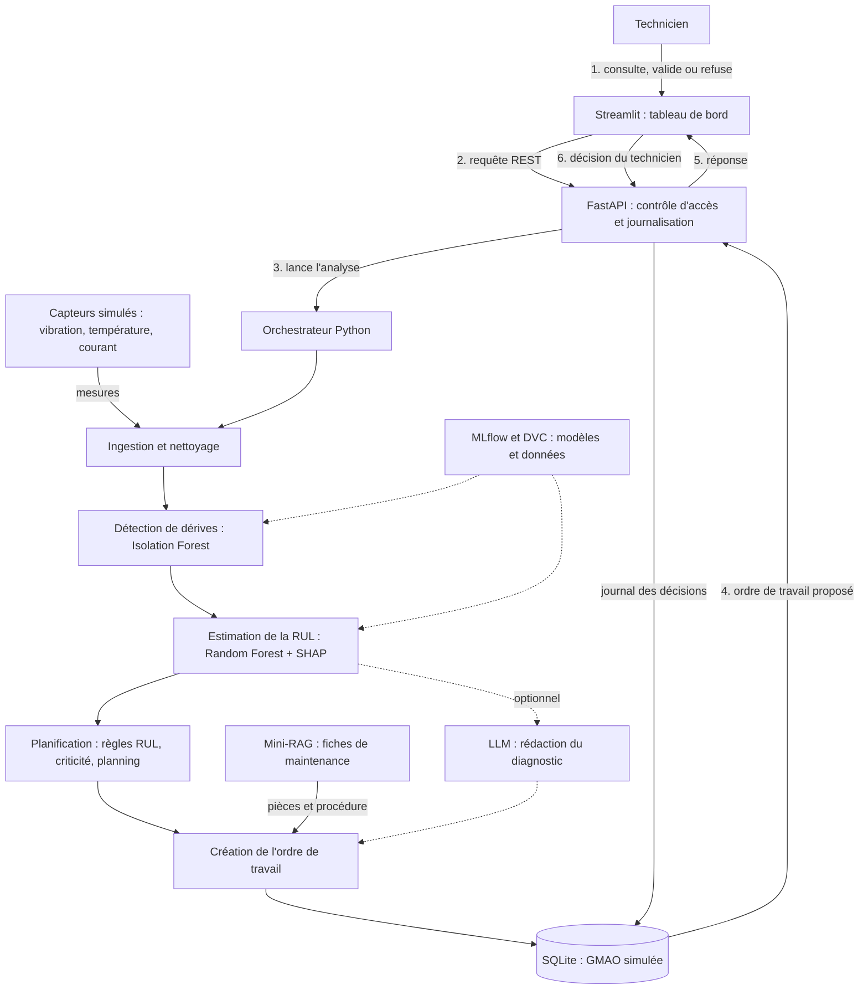

# Fiche de suivi, semaine 1 : cadrage et lancement du projet

## 1. Identification du groupe

| Élément | Votre réponse |
| --- | --- |
| Nom du groupe | Hbibou_Essammouni |
| Titre du projet | Agent de maintenance prédictive |
| Sujet : numéro du catalogue, ou « hors catalogue » | 21 |
| Adresse du dépôt GitHub | https://github.com/AyaHbibou/Hbibou_Essammouni_G3_21 |
| Enseignant ajouté au dépôt (oui ou non) | oui |
| Date de remise de la fiche | 16-11-2026 |

Membres du groupe (2 à 4 lignes) :

| Nom et prénom | Compte GitHub | Rôle principal dans le projet |
| --- | --- | --- |
| Hbibou Aya|  https://github.com/AyaHbibou| Descriptif+Maquette |
| Essammouni Khaoula| https://github.com/essammounikhaoula-source | Dataset+Pipeline |
|  |  |  |
|  |  |  |

## 2. Sujet et besoin

| Question | Votre réponse |
| --- | --- |
| Besoin en une phrase |  un agent de maintenance prédictive : il reçoit en continu des mesures de capteurs (IoT simulé), compare le comportement actuel à un profil normal appris, détecte les dérives progressives, estime la durée de vie restante (RUL) et propose une fenêtre d’intervention compatible avec le planning de production.  |
| Utilisateur final : qui se sert de l'application | Technicien|
| Ce que fait l'application, vu par l'utilisateur (3 lignes au plus) |l'agent reçoit les mesures des capteurs,nettoie les séries temporelles et compare avec au profil normal , estimation du temps de vie restant avec explication du diagnostic et préparation du l'ordre de travail dont  le technicien de maintenance le  valide ou  le refuse   |
| Approche retenue (règles, apprentissage, RAG, agent) et raison du choix | agent, pour rédiger  des diagnostic qui aide à la prise de décision  |
| Conséquence d'une erreur de l'application, et validation humaine prévue | le responsable du maintenance suit l état des équipements  |
| Sujet hors catalogue : projet du catalogue auquel il est comparable |  |

## 3. Périmètre

La version minimale est le parcours complet le plus simple, de la demande de l'utilisateur jusqu'à la réponse affichée. Elle doit fonctionner à la fin de la semaine 2.

| Rubrique | Votre réponse |
| --- | --- |
| Version minimale : le parcours que vous montrerez en semaine 2 |Prétraitement des données et implémentation de l'agent   |
| Fonction 1, indispensable | Préparation des données |
| Fonction 2, indispensable | Implémentation de l'agent |
| Fonction 3, si le temps le permet |  |
| Hors périmètre : ce que vous ne ferez pas |  |

## 4. Architecture et technologies

| Composant | Choix prévu | Dossier ou fichier dans le dépôt |
| --- | --- | --- |
| Cœur : modèle, agent ou chaîne RAG | agent  |
| API | FastAPI (Pydantic, Swagger) : `/health`, `/orders`, `/validate`, `/predict` ; clé d'API |  |
| Interface | Streamlit |  |
| Données et stockage | C-MAPSS FD001 (Parquet), GMAO simulée SQLite, versionnement DVC, suivi MLflow |   |
| Tests | pytest ; CI GitHub Actions à chaque push |  |
| Services externes et clés nécessaires | Hugging Face pour télécharger les données . Clé d'API de l'application. | |

Schéma d'architecture

## 5. Données

Règle du cours : uniquement des données publiques, fictives ou anonymisées.

| Question | Votre réponse |
| --- | --- |
| Origine des données (source, licence) |NASA C-MAPSS (Turbofan Engine Degradation Simulation), sous-ensemble FD001. Copie utilisée : https://huggingface.co/datasets/SoyVitou/NASA-C-MAPSS-Turbofan-Engine (configuration FD001). Dépôt d'origine : https://www.nasa.gov/content/prognostics-center-of-excellence-data-set-repository  |
| Volume disponible aujourd'hui |1fichier parquet  environ 0.5MO  |
| Format |parquet  |
| Données personnelles : non, ou oui avec la méthode d'anonymisation | aucune |
| Jeu d'essai versionné dans le dépôt : chemin du fichier ou du script |  |

### Description du jeu de données

Le projet repose sur un tableau de données : le sous-ensemble FD001 de NASA C-MAPSS, copie Hugging Face (cmapss_fd001_train.parquet, environ 0,5 Mo). Il décrit la dégradation de moteurs d’avion simulés. Le jeu compte 20 631 lignes et 29 colonnes. Une ligne correspond à un cycle de vol d’un moteur. Les données portent sur 100 moteurs suivis jusqu’à la panne, avec une durée de vie de 128 à 362 cycles.

Chaque ligne contient l’identifiant du moteur (unit_id), le numéro de cycle (cycle), 3 réglages, 21 capteurs et la cible RUL, le nombre de cycles restants avant la panne. Deux colonnes de service s’y ajoutent, dataset et split. Le jeu ne présente aucune valeur manquante (0 sur 20 631 lignes). Sept colonnes sont constantes (setting_3, T2, P2, epr, farB, Nf_dmd, PCNfR_dmd) et sont retirées au nettoyage, ce qui laisse 22 colonnes. Les valeurs extrêmes sont conservées, car elles font partie de la dégradation simulée. Les données sont simulées et ne contiennent aucune donnée personnelle.

Vue d'ensemble :
| Caractéristique | Votre réponse |
| --- | --- |
| Ce que représente une ligne (ou un document) | Un cycle d'un moteur : réglages, 21 capteurs et RUL à ce cycle |
| Nombre de lignes ou de documents | 20 631 lignes (100 moteurs, de 128 à 362 cycles chacun) |
| Nombre de variables (colonnes) | 29 colonnes (22 après retrait des 7 colonnes constantes) |
| Période couverte et langue | Simulation sans calendrier : l'axe du temps est le numéro de cycle. Données numériques, sans langue |
| Variable cible ou réponse attendue, s'il y en a une | `RUL` (cycles restants) ; pour la détection, étiquette « dégradé » si RUL ≤ 30 |
| Répartition de la cible : effectif par classe, ou minimum, moyenne et maximum | à compléter avec la sortie du script (minimum, moyenne, maximum de la RUL ; effectif dégradé / normal) |
| Pour un corpus de textes : longueur moyenne d'un document, en mots | Corpus de fiches de maintenance prévu : 5 à 10 fiches rédigées par le binôme.  |
| Valeurs manquantes et doublons : nombre et traitement prévu | Valeurs manquantes : 0 sur 20 631 lignes. Doublons et cycles manquants : contrôlés par `check_quality` dans `data.py` .  |
| Découpage prévu : entraînement, test, évaluation | Découpage **par moteur**, sans moteur commun entre train, val et test (assertion dans `data.py`). Proportions : à décider avec la sortie de `data.py` (test d'environ 15 moteurs). Les 50 premiers cycles de chaque moteur servent de comportement normal |
| Script qui recalcule ces chiffres : |
 
Dictionnaire des variables (extrait) :
 
| Variable | Type | Signification | Exemple de valeur | Valeurs manquantes (%) |
| --- | --- | --- | --- | --- |
| `unit_id` | nombre (identifiant) | Numéro du moteur |  | 0 |
| `cycle` | nombre | Numéro du cycle de vol |  |  0|
| `setting_1`, `setting_2` | nombre | Réglages opérationnels (`setting_3` est constant, retiré) |  | 0 |
| `T24`, `T30`, `T50`, `P30`, `Nf`, `Nc`, `Ps30`, `phi`, `BPR`, `htBleed`, `W31`, `W32`, etc. | nombre | Mesures de capteurs (températures, pressions, vitesses, débits) | |  0|
| `RUL` | nombre | Cycles restants avant la panne (cible) |  | 0 |

Trois exemples tirés du jeu de données (jeu de test : chaque moteur coupé à 3 moments de sa vie) :
 
| Exemple (entrée) | Réponse ou étiquette attendue | Nature de l'exemple |
| --- | --- | --- |
| Moteur de test coupé à RUL réelle proche de 100 cycles | RUL ≈ 100, pas d'alerte | Cas simple |
| Moteur de test coupé à RUL réelle proche de 50 cycles | RUL ≈ 50, non dégradé (seuil à 30), risque de fausse alarme | Cas difficile |
| Moteur de test coupé à RUL réelle de 30 cycles (ou proche de 10) | 30 : cas à la frontière du seuil « dégradé » ; proche de 10 : alerte attendue | Cas limite |
 

## 6. Critères de réussite

| Critère | Mesure | Valeur cible | Comment vous le vérifierez |
| --- | --- | --- | --- |
| Précision de la RUL | RMSE de la RUL sur val et test | Meilleure que la baseline « RUL moyenne » ; valeur chiffrée à décider après T7 (semaine 2) | Run MLflow (T7, T8) |
| Qualité de la détection | Taux de fausses alarmes et délai moyen entre l'alerte et la panne, sur 45 cas de test | Valeurs cibles à décider après T3 (semaine 2) | Run MLflow, évaluation complète (T18) |
| Complétude des ordres de travail | Part d'ordres complets sur 20 scénarios rédigés par l'équipe | 100 % (20 sur 20) | Tests unitaires (T9, T10) |
 

## 7. Répartition et planning sur 3 semaines

Un livrable par semaine, repéré par un tag Git. Précisez ce que chaque livrable veut dire pour votre projet.
| Semaine | Livrable attendu | Pour votre projet, concrètement | Responsable | Tag |
| --- | --- | --- | --- | --- |
| 1 | Cadrage, dépôt initialisé, squelette exécutable | Dossier de lancement (livrables 1 à 4), environnement, données C-MAPSS nettoyées et découpées, prototype de détection de dérives, `/health` et GMAO SQLite (T1 à T6) | A (T1 à T3), B (T4 à T6) | `s1` |
| 2 | Version minimale qui fonctionne de bout en bout | Random Forest RUL avec incertitude, règles de planification, ordre de travail, orchestrateur, endpoints `/orders` et `/validate` (T7 à T12) | A (T7, T8, T11), B (T9, T10, T12) | `s2` |
| 3 | Application finale, documentation, compte rendu | `/predict`, Streamlit, Docker Compose, CI, explicabilité, évaluation, courant simulé (T13 à T19), puis documentation, rapport, tests de bout en bout, soutenance et démo (T20 à T24) | A et B | `v1.0.0` |

Répartition des responsabilités :

| Membre | Responsabilités sur les 3 semaines | Remplaçant en cas d'absence |
| --- | --- | --- |
| Essammouni (A) | Données, modèles (Isolation Forest, Random Forest, incertitude), orchestrateur, explicabilité, évaluation, documentation, rapport (19 jours) | Hbibou |
| Hbibou (B) | API, GMAO SQLite, planification, ordre de travail, tableau de bord, Docker, CI, tests de bout en bout, soutenance (19 jours) | Essammouni |

## 8. Travail réalisé en semaine 1

| Membre | Ce que j'ai fait cette semaine | Lien vers mes commits | Temps passé (heures) |
| --- | --- | --- | --- |
| Essammouni | dataset +pipeline |  |  |
| Hbibou |  Maquette +descriptif|  |  |
|  |  |  |  |
|  |  |  |  |

État du dépôt à la remise de la fiche :

- [ ] Dépôt créé, enseignant et tous les membres ajoutés
- [ ] README avec le titre, les membres, le sujet et les commandes d'installation (S1-1)
- [ ] Au moins un commit de chaque membre, depuis son propre compte (S1-2)
- [ ] `requirements.txt` installable sur un clone neuf, `.env.example` présent, aucun secret poussé (S1-3)
- [ ] Squelette exécutable et au moins un test qui passe (S1-4)
- [ ] Jeu d'essai et schéma d'architecture dans le dépôt (S1-5)
- [ ] Cette fiche poussée dans `docs/suivi/` et tag `s1` posé (S1-6)

## 9. Risques et points de blocage

| Risque ou blocage | Probabilité (faible, moyenne, forte) | Ce que vous ferez si cela arrive | Qui surveille |
| --- | --- | --- | --- |
|  |  |  |  |
|  |  |  |  |
|  |  |  |  |

Question à poser à l'enseignant, s'il y en a une :

## 10. Engagements pour la semaine 2

Trois engagements au plus, chacun vérifiable dans le dépôt. Ils seront relus dans la fiche de la semaine 2.

| Engagement | Responsable | Comment on saura que c'est fait |
| --- | --- | --- |
|  |  |  |
|  |  |  |
|  |  |  |

## Cadre réservé à l'enseignant

| Rubrique | Barème | Note |
| --- | --- | --- |
| Cadrage : sujet, périmètre, critères mesurables (rubriques 2, 3 et 6) | 2 |  |
| Organisation : architecture, données, rôles, planning (rubriques 4, 5 et 7) | 1 |  |
| Preuves GitHub de la semaine 1, contribution de chaque membre (rubrique 8) | 1,5 |  |
| Risques et engagements pour la semaine 2 (rubriques 9 et 10) | 0,5 |  |
| **Total** | **5** |  |

Décision : sujet validé, ou fiche à reprendre avant le :

Commentaire :
