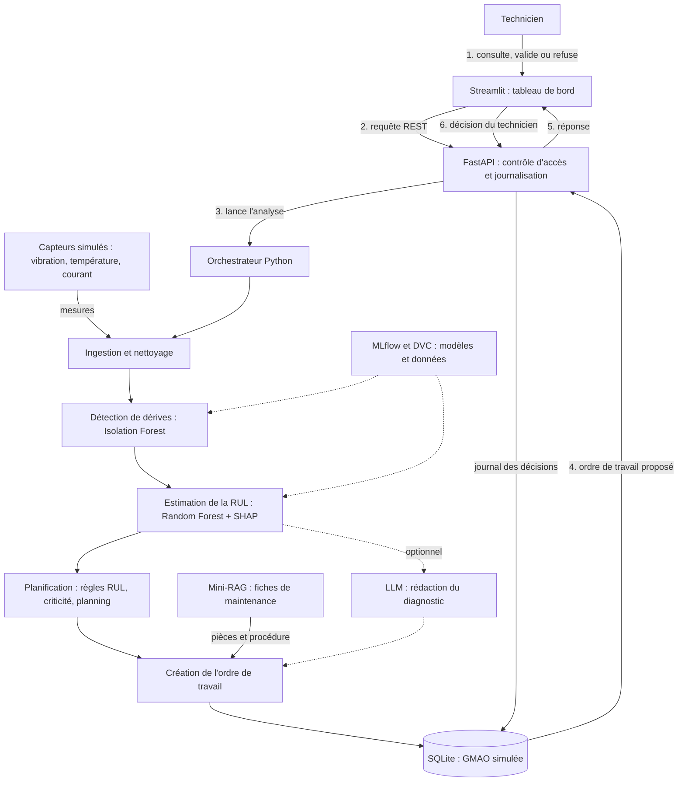

# Livrable 3 : maquette globale

**Rédacteur :** Aya Hbibou   **Relecteur :** Khaoula Essammouni  **Fichiers :** docs/semaine1/3-maquette.md + docs/semaine1/img/

## 3.1 Schéma d'architecture

**Parcours d'une requête :** le technicien ouvre le tableau de bord, Streamlit interroge l'API FastAPI, qui déclenche l'orchestrateur. Celui-ci enchaîne ingestion, détection de dérives, RUL, planification et création de l'ordre de travail. L'ordre est enregistré dans SQLite et renvoyé au tableau de bord. Le technicien le valide ou le refuse, et la décision est journalisée.

## 3.2 Légende du schéma

| Composant | Rôle | Fonctionnalité |
|-----------|------|----------------|
| Technicien | Utilisateur qui décide (validation obligatoire) | F3 |
| Streamlit | Tableau de bord : courbes, alertes, RUL, validation ou refus | F3 |
| FastAPI | Point d'entrée REST, contrôle d'accès, journalisation des décisions | F1, F2, F3 |
| Orchestrateur Python | Enchaîne les modules de la chaîne de traitement | F1, F2 |
| Capteurs simulés | Mesures de vibration, température et courant (courant simulé) | F1 |
| Ingestion et nettoyage | Valeurs manquantes et aberrantes, synchronisation, fenêtres glissantes | F1 |
| Détection de dérives | Isolation Forest entraîné sur le comportement normal | F1 |
| Estimation de la RUL | Random Forest avec incertitude, explication SHAP | F1 |
| LLM (optionnel) | Rédige le diagnostic en langage clair, sans décider | F1 |
| Planification | Règles selon la RUL, la criticité et le planning de production | F2 |
| Mini-RAG | Retrouve pièces et procédure dans les fiches de maintenance, avec citations | F2 |
| Création de l'ordre de travail | Assemble fenêtre d'intervention, pièces et procédure | F2 |
| SQLite (GMAO simulée) | Équipements, pièces, ordres de travail, journal des décisions | F2, F3 |
| MLflow et DVC | Suivi des expériences et versionnement des données et modèles | Support de F1 |
| Docker Compose et GitHub Actions | Environnement reproductible, tests et construction automatisés | Support de F1 à F3 |

## 3.3 Maquette des écrans

| Écran | Image (img/...) | Fonctionnalités affichées | Action principale de l'utilisateur |
|-------|-----------------|---------------------------|-------------------------------------|
| A. Vue d'ensemble du parc | img/ecran-a-parc.png | F1 (état et alertes), F3 | Choisir un équipement en alerte |
| B. Détail d'un équipement | img/ecran-b-detail.png | F1 (courbes, dérive, RUL, explication) | Demander la planification de l'intervention |
| C. Proposition d'ordre de travail | img/ecran-c-ordre-travail.png | F2 (fenêtre, pièces, procédure), F3 | Valider ou refuser l'ordre de travail |

**Contenu de chaque écran**

- **A. Vue d'ensemble :** tableau des équipements simulés avec nom, criticité, état (normal, dérive détectée, alerte), RUL estimée et dernière mise à jour ; filtre par état.
- **B. Détail :** courbes de vibration, température et courant ; score de dérive dans le temps ; RUL avec intervalle d'incertitude et niveau de confiance ; graphique SHAP des capteurs qui expliquent le diagnostic, avec le texte du LLM s'il est retenu ; bouton « Planifier l'intervention ».
- **C. Ordre de travail :** fenêtre d'intervention proposée et le planning de production concerné ; liste des pièces et procédure avec la fiche de maintenance citée ; boutons « Valider » et « Refuser » avec un champ de commentaire.

## 3.4 Parcours utilisateur

Scénario principal du livrable 1 :

1. **Écran A :** le technicien ouvre le tableau de bord et repère un équipement en alerte, puis clique dessus.
2. **Écran B :** il consulte les courbes, la RUL avec son incertitude et l'explication du diagnostic, puis clique sur « Planifier l'intervention ».
3. **Écran C :** il examine la fenêtre d'intervention, les pièces et la procédure, puis valide ou refuse l'ordre de travail.
