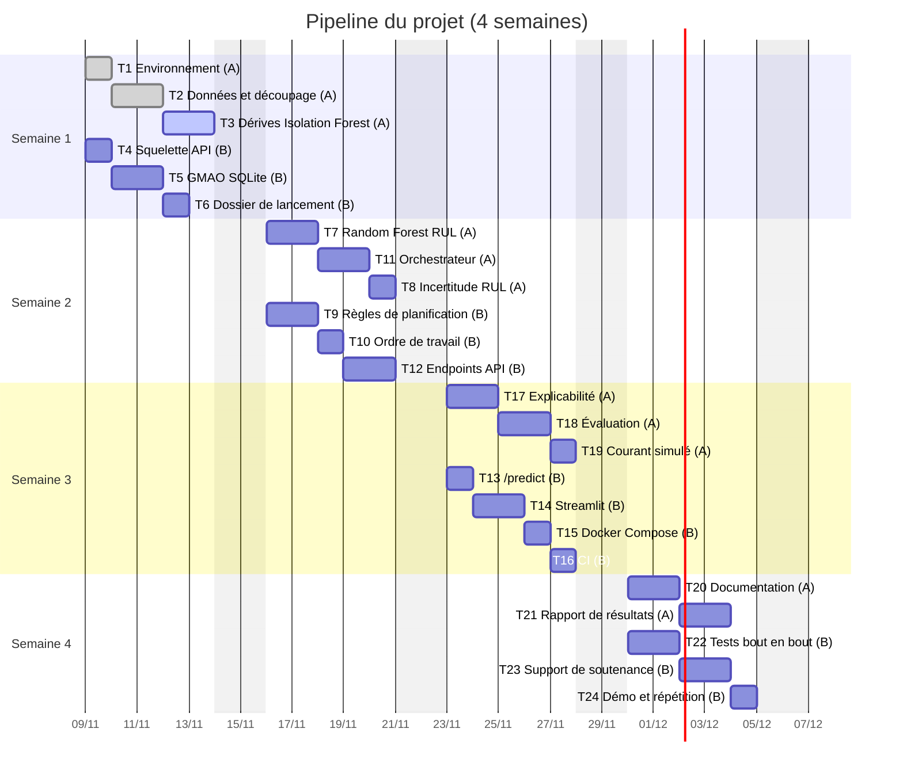

# Livrable 4 : pipeline des tâches prévues

**Consolidateur :** Essammouni  |  **Relecteur :** Hbibou
**Fichier :** `docs/semaine1/4-pipeline.md`

**Membres :** A = Essammouni (données, modèles, évaluation), B = Hbibou (API, GMAO, dashboard, Docker, CI).
**Fonctionnalités :** F0 = socle (environnement, données) ; F1 = détection de dérives ; F2 = estimation de la RUL ; F3 = planification et ordre de travail (GMAO simulée, API, tableau de bord).
**Calendrier :** semaine 1 = 9 au 13 nov. 2026, semaine 2 = 16 au 20 nov., semaine 3 = 23 au 27 nov., semaine 4 = 30 nov. au 4 déc.

## 4.1 Liste des tâches

| ID | Tâche | Fonct. | Resp. | Dépend de | Sem. | Terminée quand ? (critère vérifiable) | Durée |
|---|---|---|---|---|---|---|---|
| T1 | Dépôt Git, environnement Python, DVC, MLflow | F0 | A | - | 1 | `pip install -r requirements.txt` passe et `dvc status` est propre | 1 j |
| T2 | Chargement C-MAPSS FD001, nettoyage, découpage par moteur | F0 | A | T1 | 1 | `data.py` écrit train/val/test sans moteur commun (assertion passe) | 2 j |
| T3 | Détection de dérives (Isolation Forest) + métriques MLflow | F1 | A | T2 | 1 | Un run MLflow affiche taux de fausses alarmes et délai d'anticipation sur val et test | 2 j |
| T4 | Squelette API FastAPI (`/health`) et premier test | F3 | B | T1 | 1 | `GET /health` renvoie 200 et `pytest` passe | 1 j |
| T5 | GMAO simulée SQLite (équipements, pièces, ordres de travail) | F3 | B | T4 | 1 | Un test crée puis relit un ordre de travail complet | 2 j |
| T6 | Rédiger et fusionner le dossier de lancement (livrables 1 à 4) | F0 | B | T5 | 1 | Dossier fusionné dans `docs/semaine1/`, relu par A | 1 j |
| T7 | Random Forest pour la RUL + suivi MLflow | F2 | A | T2 | 2 | RMSE sur val et test loggé, meilleur qu'une baseline (RUL moyenne) | 2 j |
| T8 | Erreur asymétrique et intervalle d'incertitude de la RUL | F2 | A | T7 | 2 | Métrique asymétrique loggée ; intervalle fourni pour chaque prédiction | 1 j |
| T9 | Règles de planification (RUL, criticité, planning simulé) | F3 | B | T5 | 2 | 10 cas de test unitaires renvoient la fenêtre attendue | 2 j |
| T10 | Génération de l'ordre de travail | F3 | B | T5, T9 | 2 | 100 % des ordres générés sur les cas de test sont complets | 1 j |
| T11 | Orchestrateur Python (dérive, RUL, planification, ordre de travail) | F1-F3 | A | T3, T7, T9 | 2 | Une commande traite un équipement simulé et crée un ordre de travail | 2 j |
| T12 | Endpoints `/orders` et `/validate` + clé d'API | F3 | B | T10 | 2 | Swagger documenté ; test : 401 sans clé, 200 avec clé | 2 j |
| T13 | Brancher l'orchestrateur sur l'API (`/predict`) | F1-F3 | B | T11, T12 | 3 | `POST /predict` renvoie dérive, RUL, intervalle et ordre de travail | 1 j |
| T14 | Tableau de bord Streamlit (courbes, alertes, validation du technicien) | F3 | B | T13 | 3 | Le technicien valide un ordre de travail depuis le tableau de bord | 2 j |
| T15 | Docker Compose (api, dashboard, mlflow) | F3 | B | T14 | 3 | `docker compose up` démarre les 3 services et `/health` répond | 1 j |
| T16 | CI GitHub Actions (tests à chaque push) | F0 | B | T4 | 3 | Le workflow est vert sur la branche principale | 1 j |
| T17 | Explicabilité : importance des variables et diagnostic en langage clair | F2 | A | T7, T11 | 3 | Chaque alerte indique ses 3 capteurs principaux et un niveau de confiance | 2 j |
| T18 | Évaluation complète sur le jeu de test (45 cas + 20 scénarios) | F1-F3 | A | T11 | 3 | Tableau de résultats généré et enregistré dans MLflow | 2 j |
| T19 | Courant moteur simulé, cohérent avec la dégradation | F0 | A | T2 | 3 | Le courant simulé est ajouté aux données avec un graphique de contrôle | 1 j |
| T20 | Documentation (architecture, données, modèles, limites, usage) | F0 | A | T18 | 4 | Documents relus par B, liens vérifiés | 2 j |
| T21 | Rapport des résultats mesurés (MLflow, graphiques) | F0 | A | T18, T20 | 4 | Rapport avec métriques, limites et incertitude de la RUL | 2 j |
| T22 | Tests de bout en bout et corrections | F0 | B | T15, T16 | 4 | Parcours complet exécuté sans erreur, code gelé et étiqueté (tag Git) | 2 j |
| T23 | Support de soutenance | F0 | B | T21 | 4 | Support relu par A, durée de présentation minutée | 2 j |
| T24 | Script de démonstration et répétition | F0 | B | T22, T23 | 4 | Répétition complète réussie, démo déroulée en moins de 5 min | 1 j |

## 4.2 Jalons hebdomadaires

| Semaine | Jalon démontrable | Tâches qui y mènent |
|---|---|---|
| 1 | Dossier de lancement fusionné, prototype en script | T1, T2, T3, T4, T5, T6 |
| 2 | Agent exposé par l'API, premiers tests | T7, T8, T9, T10, T11, T12 |
| 3 | MVP complet, Docker et CI au vert | T13, T14, T15, T16, T17, T18, T19 |
| 4 | Résultats mesurés, code gelé, soutenance | T20, T21, T22, T23, T24 |

## 4.3 Vue chronologique

## 4.4 Chemin critique et charge

**Chemin critique :** T1, T2, T7, T11, T13, T14, T15, T22, T24. Un retard sur l'une de ces tâches décale le MVP puis la soutenance. Le point de rendez-vous le plus sensible est T13, qui attend à la fois T11 (côté A) et T12 (côté B).

**Charge par membre :**
- **A (Essammouni) :** 19 jours (semaine 1 : 5 j, semaine 2 : 5 j, semaine 3 : 5 j, semaine 4 : 4 j).
- **B (Hbibou) :** 19 jours (semaine 1 : 4 j, semaine 2 : 5 j, semaine 3 : 5 j, semaine 4 : 5 j).
- **Écart :** 0 jour.

## Critères d'acceptation (à vérifier par le récepteur)

- [ ] Aucune tâche ne dépasse 2 jours.
- [ ] Chaque fonctionnalité du MVP a au moins une tâche, et chaque tâche a un critère de fin vérifiable.
- [ ] Le MVP est complet au plus tard en fin de semaine 3 (T13 à T19).
- [ ] Chaque membre a saisi ses propres tâches ; l'écart de charge reste inférieur à 2 jours.
- [ ] Les tâches existent comme issues GitHub.
